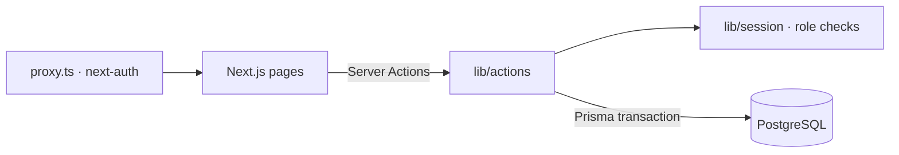

<div align="center">

# 💊 Pharmacy Management System

### Pharmacy point-of-sale and inventory system with barcode scanning, FEFO batches, invoices and reports

        

**[📦 Source](https://github.com/n1j10/pharmacy)** · Arabic (RTL) interface

</div>

---

## ✨ Overview

A pharmacy point-of-sale system for daily operations. Sellers scan barcodes and issue invoices, while admins manage medicines, stock batches, customers, users and settings. Stock is dispensed **FEFO** (*First-Expired, First-Out*), and every sale or return records the exact batch it used.

## 🧩 Features

- 🧾 **Point of Sale**: camera barcode scanner, cart, discounts, cash or card, auto-numbered invoices (`INV-2026-0001`, yearly counter)
- 📦 **Batch inventory (FEFO)**: each medicine has batches with a cost price and expiry date, and sales deduct from the batch that expires first
- ↩️ **Returns**: full or partial. Quantities go back to **the same batches** they came from, and the discount is pro-rated
- 🏷️ Medicines and categories, printable barcodes
- 👥 Customers, users and roles (**ADMIN / SELLER**), account activation
- 📊 Reports dashboard with charts (Recharts)
- ⚙️ Pharmacy settings (name, receipt footer, currency)

## 🏗️ Architecture



Each sale runs in **one database transaction**: validate the cart, deduct from batches (FEFO), record `SaleDeduction` rows, then create the invoice. If any step fails, everything rolls back.

## 🔐 Security

Security was designed in from the start:

| Area | Implementation |
| --- | --- |
| Authentication | NextAuth credentials with bcrypt (cost 12) and JWT sessions |
| Session check | Every server call re-checks the account in the database, so a deactivated user or demoted admin loses access **immediately** instead of when the JWT expires |
| Authorization | Routes are guarded in `proxy.ts`, and every admin action (categories, medicines, batches, users, settings) calls `getAdminUser()` |
| Data isolation | Sellers can only see and return **their own** invoices |
| Concurrency | A conditional stock decrement (`quantity >= n`) prevents overselling during concurrent sales, and returns run in a **Serializable** transaction |
| Validation | Integer quantities, non-negative discounts, email format, password policy (8–72 characters), role allow-list |
| HTTP headers | HSTS, `X-Frame-Options`, `nosniff`, `Referrer-Policy`, `Permissions-Policy`; `X-Powered-By` removed |

> Secrets are stored only in environment variables. `.env*` is git-ignored, and `.env.example` contains placeholders only.

## 🛠️ Tech Stack

| Layer | Tech |
| --- | --- |
| Framework | Next.js 16 · React 19 · Server Actions |
| Database | PostgreSQL · Prisma (16 models, Decimal money) |
| Auth | NextAuth + Prisma Adapter + bcryptjs |
| UI | Tailwind CSS v4 · shadcn/ui · Recharts |
| Barcodes | Camera scanner + printable barcode labels |

## 🚀 Getting Started

```bash
# 1. Install
npm install

# 2. Configure environment
cp .env.example .env        # fill in the values

# 3. Database
npx prisma migrate deploy   # or: npx prisma db push
npm run seed               # optional sample data

# 4. Run
npm run dev                 # http://localhost:3000
```

## ☁️ Deployment

Deployed on **Vercel**. Add the variables from `.env.example` under *Project → Settings → Environment Variables*, then push. Vercel builds and deploys automatically.

## 👤 Author

**n1j10**, full-stack engineer (Next.js · TypeScript · Node.js · PostgreSQL)

[](https://github.com/n1j10)

> If you find this project useful, a ⭐ on the repo is appreciated.
